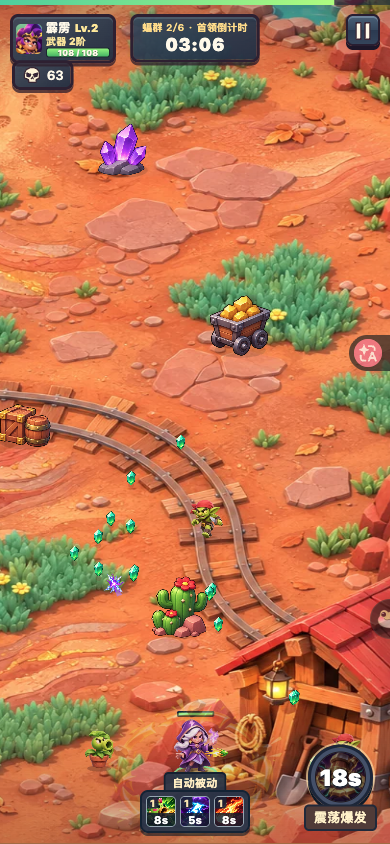

# Bramble Brawl

[简体中文](README.md) · [Play on mobile](https://bramble-brawl.xiaosang.cc/) · [GitHub](https://github.com/holynova/bramble-brawl)

Pick a hero and three passive skills, then drag to dodge through the crystal mine. Your weapon aims automatically. When a wave closes in, trigger Shockwave to push enemies back. It recharges in 18 seconds.

## Survive a contract

Collect green crystals to level up. Choose one of three cards at each level. Weapons and passive skills start at rank one, reach rank five and can evolve after rank three. The three contracts bring out the crystal giant at four, six and eight minutes. Defeat it to unlock the next contract. Gold buys permanent camp upgrades. Progress stays in this browser.

Drag anywhere to move or use WASD and arrow keys. Space triggers Shockwave, and Escape pauses. Hiding the tab also pauses the fight. Open camp settings to adjust music and effects.

## Run and publish

Use Node.js 22.13 or newer. Run `npm ci`, `npm test` and `npm run dev`. The production command is `npm run build`. Cloudflare Pages builds `main` after `git push origin main` and serves `dist/`. Run `npm run standalone` for a single-file edition.

