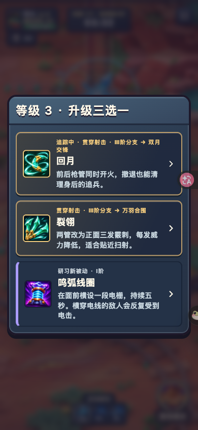

# 沙棘乱斗 · Bramble Brawl

手机竖屏优先的单机幸存者游戏。选择一位英雄，带着自己的三个起手被动，进入矿谷收集绿晶，在怪潮中进化武器，击败晶核巨像领取赏金。

[English](README.en.md) · [手机试玩](https://bramble-brawl.xiaosang.cc/) · [GitHub](https://github.com/holynova/bramble-brawl)



## 开玩

进入营地后会在后台准备战斗引擎、当前地图、所选英雄的动作图、敌人和特效。「开始乱斗」底部的细线表示准备进度，随时可以点击出战。切换英雄或关卡时会复用已备好的公共资源，提前出战会显示剩余加载进度。

拖动战场任意空地走位，武器自动瞄准。右下角的「震荡爆发」是唯一的主动技能，冷却 18 秒。被包围时释放可击退敌人、打断普通怪物的攻击，并获得短暂保护。桌面支持 WASD 或方向键走位、空格释放、Esc 暂停。切到其他标签页也会暂停。

营地点英雄即可出战，三个自带被动会随英雄一起装备。它们自动触发，各有独立冷却。炮芽种在脚下，巡蜂伴随英雄，火径按移动距离落下，冰雷等敌人踏入才会引爆。战场底部显示每项被动的剩余秒数。游戏声音与战斗音乐可在营地设置中调整，点「试听武器音效」可听当前英雄的攻击声。

## 英雄技能池与流派专精

营地「英雄技能池」列出当前英雄自动装备的三项被动和升级时可研习的六项，点击技能可预览其两条进化路线。「流派手册」可以预览其他英雄和打法。金币、装备、关卡、战绩与设置会从旧存档读取。

| 流派 | 英雄及起手被动 | 让这套打法成立的操作 |
| --- | --- | --- |
| 疾风回刃 | 回砂（月牙刃轮、金棘护盾、镜砂分身） | 出镖后向侧面绕，改变返程穿过怪群的位置。移动蓄满后普攻附带穿透风刃。 |
| 燎原火径 | 烬铃（余烬足迹、陨星火球、日轮焰盘） | 在追兵路线上铺火，折返引怪经过同一片火池，让灼伤击杀留下野火。 |
| 蚀魂收割 | 缝影（蚀魂印记、荆棘旋风、渡魂灯） | 在怪群边缘给敌人挂印，镰击优先追击残血目标。收割带印敌人可回血并弹出魂丝。 |
| 蜂塔工事 | 铁墩（炮芽哨兵、巡游蜂、牵引锚） | 站稳 1.2 秒部署哨塔，在炮芽和巡蜂的覆盖下守住一侧，再迁移阵地。 |
| 冻土碎击 | 刺头（冰晶新星、冻土矿雷、霜羽飞梭） | 把追兵引到冰雷上，趁减速用双枪穿击，碎冰可波及邻敌。 |
| 雷网共振 | 霹雳（连锁闪电、鸣弧线圈、蓄电战鼓） | 沿电栅横拉怪群，每第三次被动发动另放出一道连锁电弧。 |

主武器和被动都带有流派标签。凑出两个同系来源即可触发该系联动，混搭可以同时激活多个流派。自英雄六级起，每逢三级，已激活流派的专精有机会占用三张升级卡中的一张。整局可选一项，例如将风刃变成三向扇射，或让电链命中三个目标后给被动回充。暂停和结算可查看当局专精以及每个流派实际触发了几次。

## 通缉令

| 关卡 | 首领登场 | 本关威胁 |
| --- | --- | --- |
| 落日矿谷 | 4 分钟 | 第二波加入截路矿印与冲刺蝠，第四波起会并排落石封路。 |
| 紫晶暴动 | 6 分钟 | 四名精英，矿印更频繁，部分蝠群会从行进方向截击。 |
| 终极通缉 | 8 分钟 | 五名精英，更密集的夹击，矿印范围更大，反应时间更短。 |

首领出现后计时切换为整局已用时，击败首领才算通关。首领生命低于 55% 后会加快重踏。两声警铃提示红圈落点已锁定，金边合拢时命中，横切或折返都可以躲开。三份通缉令依次解锁。结算金币可强化拳套、快靴和徽章。营地进度保存在当前浏览器，重载页面会结束当前战斗。

首批突袭在第 15 秒抵达，第二波起部分地面敌人会截向前路，第三波起突袭会从两侧夹击。第 28 秒首次出现裂地带，警铃响起时方向已经锁定，在金边填满前横移即可脱身。巨像生命低于 55% 后交替施放延迟落击和裂地带。第二、三关的巨像每三次重踏还会召来两翼蝠群。

## 武器与被动成长

捡满绿晶会暂停战斗。每次只发三张不同的卡，点一张立即生效。三阶分支各占一张，卡上标明此次招式和对应终式。每位英雄有九项被动。六名英雄的起手三项互不重复，各有一个专属技能。其余六项可研习技能中，每局最多学两项。点新被动的卡面即研习。五个被动位选满后，本局专注携带技能，已有投入和路线持续生效，其余卡仍可查阅。

| 阶段 | 玩家得到什么 |
| --- | --- |
| Ⅰ | 武器或被动的起手形态。新学的技能很快就会首次自动发动。 |
| Ⅱ | 每项技能独有的首次改造。例如火池耗尽喷发，镜砂分身在两侧布置镜像，冰梭命中后反向发射。 |
| Ⅲ | 二选一锁定路线。武器改变主攻击方式。被动可以在冷却过半后通过移动、站定或击杀提前发动，并带上对应路线的招式。 |
| Ⅳ | 路线出现新行为，例如驻月悬停切割、冰雷打断冲刺、塔下护盾或疫印死亡传播。 |
| Ⅴ | 获得终式，例如双月沿不同路径折返、两翼扇刃合围、工事随英雄迁移、主雷分出独立子雷。 |

六件武器和十八项被动各有两条路线，共有 48 种技能与路线搭配，跨技能共享十二种终式。在营地可从流派手册看推荐武器路线，也可在英雄技能池中点被动卡面。暂停战斗后进入「路线图鉴」，点击武器或被动可「追踪终式」，下次升级的三张卡中会优先给出该目标缺少的一步。三阶选定后本局锁定分支。

例如刺头的双枪二阶分裂，三阶可以选「裂翎」，将正面普攻变成扇射，四阶从侧面交错切入，五阶「万羽合围」由两翼对射。另一条「回月」把枪口分向前后，回刃能在折返点悬停，五阶成为「双月交锋」。例如刺头可以从储备中再学月牙刃轮和金棘护盾，形成冰控贴身打法。

## 运行与重建

使用 Node.js 22.18+ 和 npm。

```sh
npm ci
npm run dev
npm test
npm run build
npm run standalone
```

生产站点生成在 `dist/`。单文件版生成在 `release/沙棘乱斗.html`，把它保存到电脑后可直接用浏览器打开。也可以使用 `npm run standalone -- /path/to/game.html` 指定成品位置。两个构建均包含所需的图片、引擎和音频逻辑。

## 美术与实现

大厅全景、六位英雄、敌人、三个战场、技能牌、装备和战斗特效均为本项目生成的原创位图。原画提示词、文件位置和裁切方法在 `art/`，游戏使用的压缩资源在 `public/art/`。实战采用十一套 4 × 4 动作图集，覆盖六名英雄、三类普通敌人、晶核巨像和炮芽。走路按实际位移切换步相，炮芽出土后原地开火。蓄力、命中与收招共用战斗时钟。图集重建方法在 [动作美术目录](art/motion/README.md)。震荡图标与透明冲击波的来源和重建方法在 [震荡美术目录](art/nova/nova-art-log.md)。八小节矿谷音乐、六款武器的出手声、命中、受伤和格挡声由 Web Audio 在本地合成。

`src/simulation.ts` 管理战斗规则，`src/battle.ts` 负责 Phaser 渲染和走位输入，`src/main.ts` 连接营地、英雄技能池、升级和结算。新增英雄、专精与部署物由 src/arsenal.ts 处理，流派匹配与搭配由 src/builds.ts 管理。快速测试覆盖进化、混搭、六项专精的实际效果、掉落收益、关卡流程和存档。六位英雄和首批进化的原画与裁切记录在 art/builds，锻造卡绘及新被动的母版、导出脚本在 art/forge。src/forge.ts 定义路线，src/forging.ts 执行锻造后的战斗行为。

Cloudflare Pages 在 `git push origin main` 后构建并发布 `dist/`。

<a href="https://bramble-brawl.xiaosang.cc/"></a>
